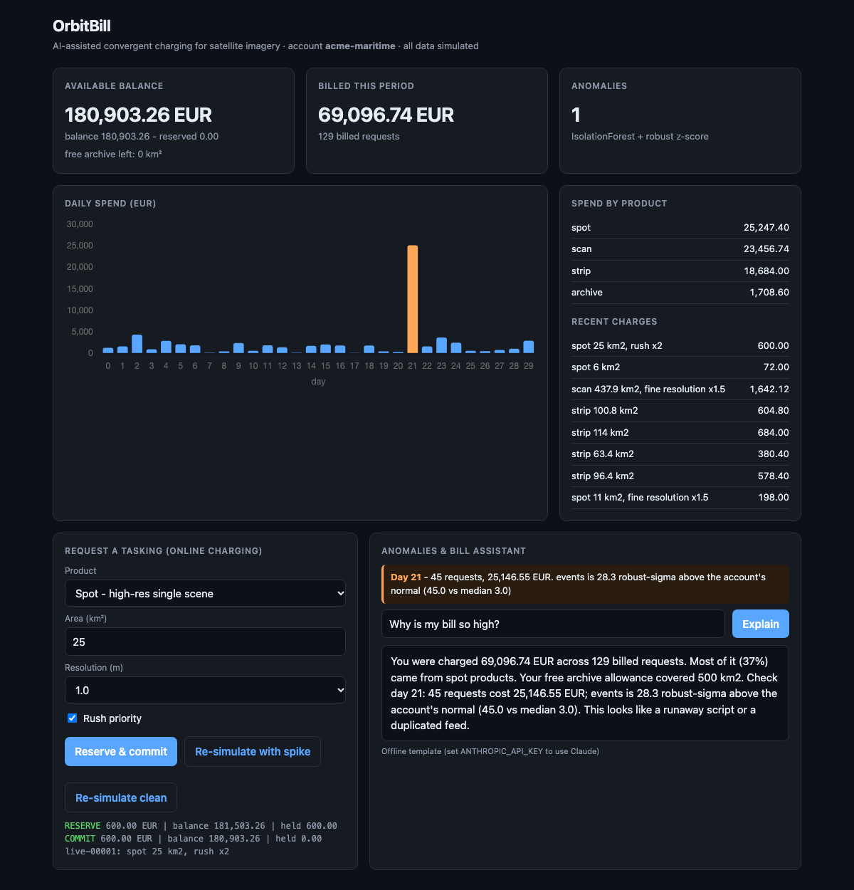

# OrbitBill

**AI-assisted convergent charging for satellite imagery.** A small online charging system (OCS) that rates, authorises and bills usage of a SAR-style imagery service, with an anomaly detector and a plain-language bill assistant on top.

> Independent portfolio project. All data is simulated; it is not affiliated with or built on data from any satellite operator.



## Why this exists
In telecom, convergent charging decides in real time whether a subscriber may use a service and what it costs. Satellite data is moving to the same usage-based model (tasking, downlink, archive downloads). OrbitBill applies the telecom pattern to that domain.

## What it does
| Layer | What | Where |
|---|---|---|
| Rating | Per-km² tariffs by product (spot / strip / scan / archive), fine-resolution and rush multipliers, free archive allowance consumed before money | `orbitbill/rating.py` |
| Online credit control | `reserve -> commit / release` against balance, idempotent retries, duplicate events billed once (the Diameter Gy pattern) | `orbitbill/credit_control.py` |
| Simulator | 30 days of synthetic usage, an injected runaway-script spike, retransmitted duplicate events | `orbitbill/simulator.py` |
| Anomaly detection | IsolationForest on daily aggregates, confirmed by a robust (median/MAD) z-score gate | `orbitbill/anomaly.py` |
| Bill assistant | Claude (`claude-sonnet-5-5`) explains the bill from structured data; deterministic template when no API key | `orbitbill/explain.py` |
| API + UI | FastAPI, single-page dashboard | `orbitbill/api.py`, `static/index.html` |

## Run it
```bash
python3 -m venv .venv && source .venv/bin/activate
pip install -r requirements.txt
python -m pytest -q                                # 19 tests
uvicorn orbitbill.api:app --port 8000              # open http://localhost:8000
export ANTHROPIC_API_KEY=...                       # optional: Claude-written explanations
```

## Design notes
- **Reserve before delivery.** A tasking request is authorised against *available* balance (balance minus holds) before anything is "captured", so concurrent requests cannot overspend.
- **Forest proposes, z-score confirms.** On 30 data points an unsupervised model alone produced a false alarm on a legitimately large scan day (4.3 sigma). Gating at 6 sigma separates the injected spike (28 sigma) from normal heavy-tailed usage, and is covered by tests in both directions.
- **LLM only explains, never computes.** All numbers come from the ledger; Claude gets JSON and is told not to invent figures. If the API fails, billing and the template explanation still work.
- Bug found by looking at the screenshots: live requests used wall-clock time and created a day-74-million bar. Live events now use the simulation clock (regression test included).

## What I'd do differently / next
- Persist to SQLite/Postgres and add real concurrency control (the in-memory engine is single-process).
- Replace daily aggregates with per-event features and evaluate against labelled anomalies instead of one injected spike.
- Multi-account support, tariff versioning and a proper Diameter/REST (3GPP CHF-style) interface.
- Currency in integer cents instead of floats.

## Built with
Python, FastAPI, scikit-learn, Chart.js, pytest, GitHub Actions. Developed with Claude Code as an AI pair-programmer (design, review of every change and the anomaly thresholds were decided by me).
